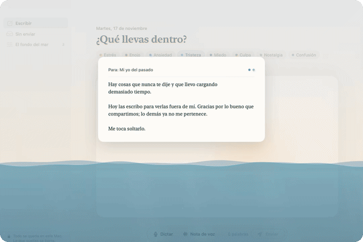
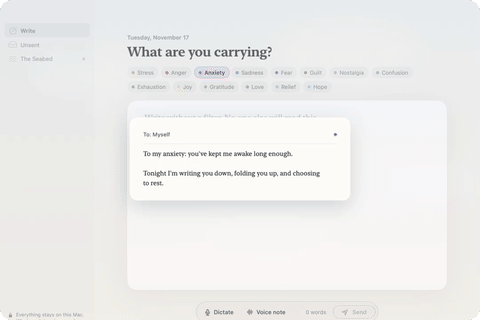
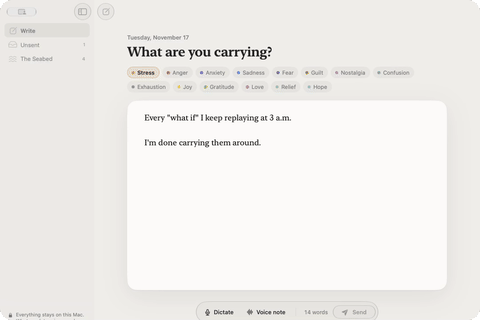
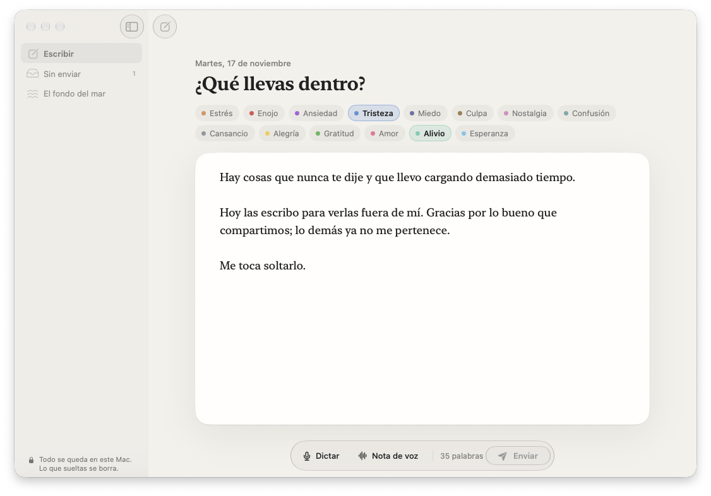
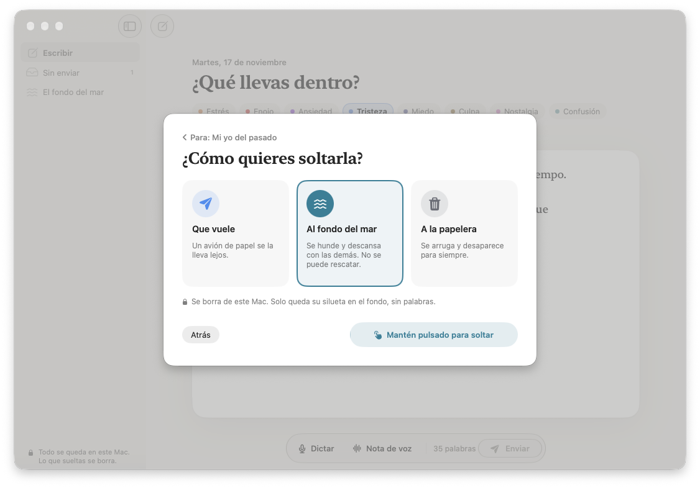
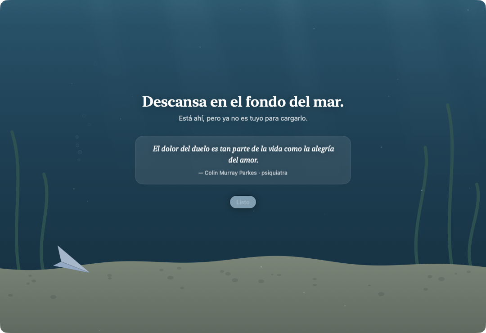

<p align="center">
  
</p>

<h1 align="center">Suelta</h1>

<p align="center">
  Escribe lo que llevas dentro. Elige para quién es. Y déjalo ir.<br>
  <em>Write what you're carrying. Choose who it's for. Then let it go.</em>
</p>

<p align="center">
  <a href="../../releases/latest"><b>Descargar para Mac</b></a> ·
  <a href="README.md">English</a> ·
  Gratis y de código abierto (GPL v3)
</p>

<p align="center">
  
</p>

<p align="center">
  <a href="https://alternativeto.net/software/suelta/about/?utm_source=badge&utm_medium=referral" target="_blank"></a>
</p>

---

## Por qué existe

Todos cargamos cosas que nunca dijimos: a una expareja, a la familia, a un amigo, a Dios, a nuestra fe, a nuestro psicólogo o a nosotros mismos. Lo que nos estresa, lo que nos enoja, lo que nos pesa… y también lo que nos alegra.

Escribirlo ayuda. El psicólogo James Pennebaker lleva estudiando la **escritura expresiva** desde los años 80: poner en palabras lo que vivimos cambia la forma en que lo cargamos. Verlo fuera de ti, releerlo y después **soltarlo** es un ritual sencillo y poderoso.

Suelta nace para eso:

1. **Escribes** sin filtro, o **hablas** y se escribe solo, o grabas una nota de voz.
2. Marcas **lo que sientes**: estrés, enojo, ansiedad, tristeza, culpa, alegría, gratitud…
3. Eliges **para quién es**: para ti, tu ex, tu familia, Dios, alguien que ya no está…
4. Y decides **cómo soltarlo**:
   - ✈️ **Que vuele**: la carta se dobla en un avión de papel y despega.
   - 🌊 **Al fondo del mar**: se hunde y descansa con las demás. Puedes verlas, pero no rescatarlas.
   - 🗑️ **A la papelera**: se arruga, cae a la papelera y desaparece para siempre.

<p align="center">
  
  
</p>
5. Al final aparece una frase breve de psicología relacionada con lo que sentías.

El envío es simbólico: **nadie recibe nada**. La carta se borra de tu Mac en el momento en que la sueltas.

<p align="center">
  
  
  
  
</p>

## Privacidad

- **Todo se queda en tu Mac.** Suelta no tiene servidores, cuentas, anuncios ni analíticas, y no se conecta a internet.
- Las cartas que todavía no has soltado se guardan solo en tu Mac (`~/Library/Application Support/Suelta`).
- Al soltar una carta se borran su texto y su audio. Si va al mar, solo queda su silueta, sin palabras.
- El dictado usa el reconocimiento de voz de macOS y, cuando el Mac lo permite, funciona sin conexión.

## Instalar

**Requisitos:** macOS 26 (Tahoe) o posterior.

1. Descarga `Suelta-Instalador.pkg` desde la [última versión](../../releases/latest).
2. Ábrelo. En el paso **Tipo de instalación** elige el idioma: **Español** o **English**.
3. Abre Suelta desde Spotlight o Launchpad.

> **Aviso de macOS:** por ahora el instalador no está firmado con una cuenta de Apple Developer, así que macOS puede decir que viene de un desarrollador no identificado. Para abrirlo: clic derecho sobre el archivo › **Abrir**, o en **Ajustes del Sistema › Privacidad y seguridad › Abrir igualmente**.

Puedes cambiar el idioma cuando quieras en **Suelta › Ajustes** (⌘,).

### Atajos

| Atajo | Acción |
| --- | --- |
| ⌘N | Nueva carta |
| ⌘↩ | Enviar (elegir destinatario y destino) |
| ⌘D | Dictar / dejar de dictar |
| ⌘, | Ajustes: idioma y frase al soltar |
| ⌘2 / ⌘3 | Sin enviar / El fondo del mar |

## Compilar desde el código

Solo necesitas las herramientas de línea de comandos de Xcode (`xcode-select --install`).

```bash
git clone https://github.com/bybryanchavez-dev/suelta.git
cd suelta
bash build.sh          # compila e instala en Aplicaciones
bash build.sh --pkg    # crea el instalador en build/Suelta-Instalador.pkg
```

La app está hecha en **Swift y SwiftUI**, sin dependencias externas. Las animaciones se dibujan con `Canvas`.

| Carpeta | Contenido |
| --- | --- |
| `Sources/` | Código de la app |
| `Resources/` | Icono, sonidos e `Info.plist` |
| `installer/` | Instalador `.pkg` con selección de idioma |
| `docs/` | Imágenes de este README |

## Hoja de ruta

Por ahora Suelta funciona en **Mac**. La idea es llevarla también a:

- [ ] **iPhone y iPad**: gran parte del código SwiftUI se puede reutilizar.
- [ ] **Android**
- [ ] **Windows**
- [ ] Más idiomas y más frases.

¿Quieres ayudar? Lee [CONTRIBUTING.md](CONTRIBUTING.md).

## Importante

Suelta es una herramienta de bienestar personal. **No sustituye a la ayuda profesional.** Si estás pasando por un momento difícil, habla con un profesional de la salud mental. Si estás en peligro, llama a los servicios de emergencia de tu país (112 en España y la UE, 911 en EE. UU. y México). En España, la línea de atención a la conducta suicida es el **024**; en EE. UU., el **988**.

## Créditos

Las frases que aparecen al final son citas breves de sus autores (Carl Rogers, Viktor Frankl, Brené Brown, Susan David, Harriet Lerner, Elisabeth Kübler-Ross y David Kessler, Edith Eger, Kristin Neff, Erich Fromm y otros), con su nombre en cada una. Están en [`Sources/Quotes.swift`](Sources/Quotes.swift).

## Licencia

Copyright © 2026 Bryan Chavez.

Suelta es software libre bajo la licencia **GNU GPL v3**. Puedes usarla, estudiarla, mejorarla y compartirla. Si publicas una versión modificada, también debe ser de código abierto con la misma licencia. Consulta [LICENSE](LICENSE).

