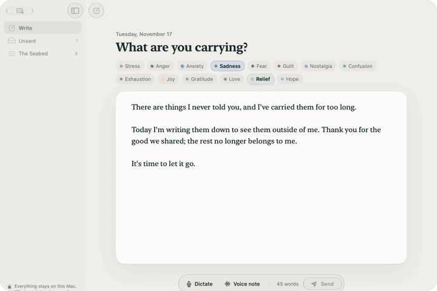
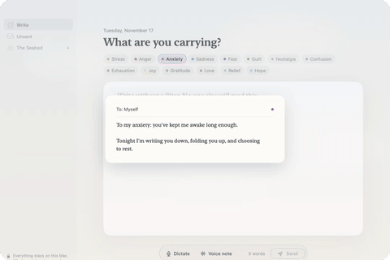
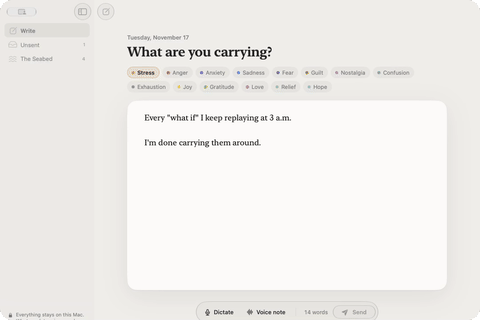

<p align="center">
  
</p>

<h1 align="center">Suelta</h1>

<p align="center">
  Write what you're carrying. Choose who it's for. Then let it go.<br>
  <em>"Suelta" means "let go" in Spanish.</em>
</p>

<p align="center">
  <a href="../../releases/latest"><b>Download for Mac</b></a> ·
  <a href="README.es.md">Español</a> ·
  Free and open source (GPL v3)
</p>

<p align="center">
  
</p>

<p align="center">
  <a href="https://alternativeto.net/software/suelta/about/?utm_source=badge&utm_medium=referral" target="_blank"></a>
</p>

---

## Why it exists

We all carry things we never said: to an ex, to our family, to a friend, to God, to our faith, to our therapist, or to ourselves. Things that stress us, anger us, weigh on us… and things that make us happy, too.

Writing it down helps. Psychologist James Pennebaker has studied **expressive writing** since the 1980s: putting what we live through into words changes how we carry it. Seeing it outside of you, rereading it, and then **letting it go** is a simple, powerful ritual.

That's what Suelta is for:

1. **Write** without a filter, **dictate** and let it type for you, or record a voice note.
2. Mark **how you feel**: stress, anger, anxiety, sadness, guilt, joy, gratitude…
3. Choose **who it's for**: yourself, your ex, your family, God, someone who's gone…
4. Decide **how to let it go**:
   - ✈️ **Let it fly**: the letter folds into a paper plane and takes off.
   - 🌊 **To the bottom of the sea**: it sinks and rests with the others. You can see them, but never recover them.
   - 🗑️ **To the trash**: it's crumpled up, dropped in the bin and gone for good.
5. At the end you'll see a short psychology quote that matches what you were feeling.

Nothing is actually sent. **No one receives anything**, and the letter is erased from your Mac the moment you let it go.

<p align="center">
  
  
</p>

## Privacy

- **Everything stays on your Mac.** Suelta has no servers, accounts, ads or analytics, and it never connects to the internet.
- Letters you haven't let go yet are stored only on your Mac (`~/Library/Application Support/Suelta`).
- Letting a letter go deletes its text and audio. If it goes to the sea, only its silhouette remains, with no words.
- Dictation uses macOS speech recognition and runs on-device whenever your Mac supports it.

## Install

**Requires** macOS 26 (Tahoe) or later.

1. Download `Suelta-Instalador.pkg` from the [latest release](../../releases/latest).
2. Open it. In the **Installation Type** step, choose the language: **Español** or **English**.
3. Open Suelta from Spotlight or Launchpad.

> **macOS warning:** the installer isn't notarized by Apple yet, so macOS may say it comes from an unidentified developer. To open it, right-click the file › **Open**, or go to **System Settings › Privacy & Security › Open Anyway**.

You can change the language any time in **Suelta › Settings** (⌘,).

### Shortcuts

| Shortcut | Action |
| --- | --- |
| ⌘N | New letter |
| ⌘↩ | Send (choose who it's for and how to let it go) |
| ⌘D | Dictate / stop dictating |
| ⌘, | Settings: language and quote after letting go |
| ⌘2 / ⌘3 | Unsent / The Seabed |

## Build from source

You only need the Xcode command line tools (`xcode-select --install`).

```bash
git clone https://github.com/bybryanchavez-dev/suelta.git
cd suelta
bash build.sh          # builds and installs into Applications
bash build.sh --pkg    # builds the installer at build/Suelta-Instalador.pkg
```

Suelta is written in **Swift and SwiftUI** with no third-party dependencies. The animations are drawn with `Canvas`.

| Folder | Contents |
| --- | --- |
| `Sources/` | App code |
| `Resources/` | Icon, sounds and `Info.plist` |
| `installer/` | `.pkg` installer with language selection |
| `docs/` | Images used in this README |

## Roadmap

Suelta runs on **Mac** today. The plan is to bring it to:

- [ ] **iPhone and iPad**: much of the SwiftUI code can be reused.
- [ ] **Android**
- [ ] **Windows**
- [ ] More languages and more quotes.

Want to help? Read [CONTRIBUTING.md](CONTRIBUTING.md).

## Important

Suelta is a personal wellbeing tool. **It is not a substitute for professional help.** If you're going through a hard time, please talk to a mental health professional. If you're in danger, call your local emergency number (911 in the US and Mexico, 112 in the EU). In the US you can also call or text **988**; in Spain, **024**.

## Credits

The quotes shown at the end are short excerpts attributed to their authors (Carl Rogers, Viktor Frankl, Brené Brown, Susan David, Harriet Lerner, Elisabeth Kübler-Ross and David Kessler, Edith Eger, Kristin Neff, Erich Fromm and others). They live in [`Sources/Quotes.swift`](Sources/Quotes.swift).

## License

Copyright © 2026 Bryan Chavez.

Suelta is free software under the **GNU GPL v3**. You can use, study, improve and share it. If you publish a modified version, it must also be open source under the same license. See [LICENSE](LICENSE).
